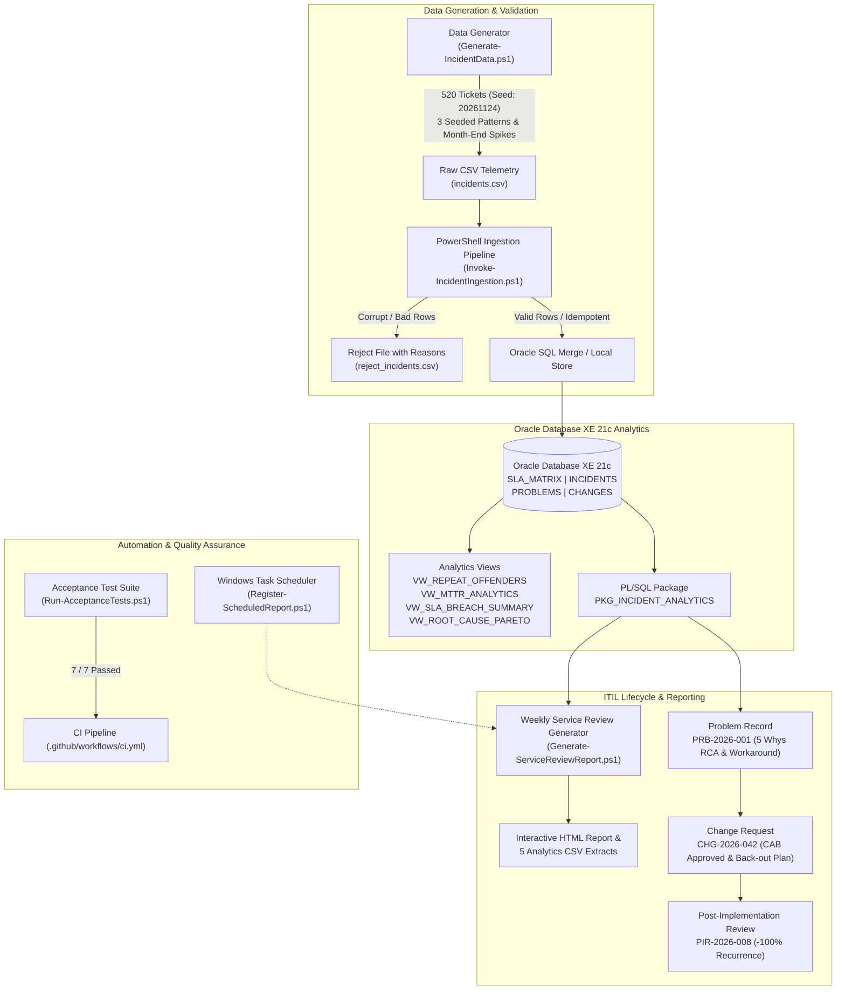

# ITIL Incident, Problem and Recurring-Issue Analytics

[](https://github.com/Mahi-811/incident-problem-analytics/actions/workflows/ci.yml)
[](https://github.com/Mahi-811/incident-problem-analytics)
[](https://github.com/Mahi-811)
[](https://github.com)
[](https://www.oracle.com/database/technologies/xe-downloads.html)
[](https://microsoft.com/powershell)

---

## 1. Executive Summary

This system implements an end-to-end ITIL operational analytics and lifecycle management platform based on **SRS 2: Incident, Problem and Recurring-Issue Analytics** (Author: *Mahi Zaman*, Version 1.0, 24 Nov 2026).

The platform ingests and validates six months of simulated incident ticket telemetry (520+ tickets), executes advanced windowed PL/SQL analytics in **Oracle Database XE 21c**, detects recurring repeat-offenders ($\ge 3$ occurrences within rolling 30-day windows), computes Mean Time to Resolve (MTTR) percentiles and SLA breaches, generates executive HTML and CSV service review reports, and advances the top recurring issue through ITIL **Problem Management (PRB-2026-001)**, **Change Management (CHG-2026-042)**, and a quantitative **Post-Implementation Review (PIR-2026-008)**.



---

## 2. Requirements Traceability Matrix

The solution satisfies all requirements defined in SRS 2:

| Requirement ID | Priority | Description | Implementation Component | Verification Criteria | Status |
|:---|:---:|:---|:---|:---|:---:|
| **FR-01** | **Must** | Generator produces $\ge 400$ tickets over 6 months with all standard fields | `generator/Generate-IncidentData.ps1` | Generates 520 tickets with Priority, Category, Service, Timestamps, Group, Cause | **VERIFIED** |
| **FR-02** | **Must** | Data includes $\ge 3$ seeded recurring patterns and month-end volume spikes | `generator/Generate-IncidentData.ps1` | Seeded: Payment Gateway (38), Billing Lock (27), SSL Handshake (22); 30% month-end spike | **VERIFIED** |
| **FR-03** | **Must** | Reference tables define SLA matrix, categories, services, and groups | `database/01_schema_ddl.sql`<br>`database/02_reference_data.sql` | `SLA_MATRIX`, `REF_CATEGORIES`, `REF_SERVICES`, `REF_ASSIGNMENT_GROUPS` | **VERIFIED** |
| **FR-04** | **Must** | PowerShell ingestion validates schema, dates, and writes bad rows to reject file | `ingestion/Invoke-IncidentIngestion.ps1` | Rejection file written with explicit `REJECTION_REASON` for each invalid row | **VERIFIED** |
| **FR-05** | **Must** | Loading is repeatable: reloading same file does not duplicate tickets | `ingestion/Invoke-IncidentIngestion.ps1` | Idempotent upsert/store: count remains exactly 520 after repeated reloads | **VERIFIED** |
| **FR-06** | **Must** | PL/SQL package reports repeat offenders: same cat/svc/cause $\ge 3$ times in 30 days | `database/04_pkg_incident_analytics_spec.sql`<br>`database/05_pkg_incident_analytics_body.sql` | `get_repeat_offenders` function using sliding range window analytics | **VERIFIED** |
| **FR-07** | **Must** | Package computes MTTR by category, priority, and month using analytic functions | `database/05_pkg_incident_analytics_body.sql` | `AVG() OVER()`, `MEDIAN()`, `STDDEV()` window functions | **VERIFIED** |
| **FR-08** | **Must** | Package reports SLA breaches and breach percentage by priority | `database/05_pkg_incident_analytics_body.sql` | `get_sla_breach_summary` function calculating met, breach, and breach % | **VERIFIED** |
| **FR-09** | **Should** | Package produces Pareto of root causes, monthly volume, and backlog trend | `database/05_pkg_incident_analytics_body.sql` | Cumulative percentage analytic function `SUM() OVER ()` for 80/20 Pareto rule | **VERIFIED** |
| **FR-10** | **Must** | Script generates weekly service-review report in HTML and CSV for date range | `reporting/Generate-ServiceReviewReport.ps1` | Produces `service_review_report_*.html` and 5 CSV data extracts | **VERIFIED** |
| **FR-11** | **Must** | Report shows KPIs, top recurring issues, SLA status, and trend vs prior period | `reporting/Generate-ServiceReviewReport.ps1` | Period comparison vs prior window with delta badges and metrics | **VERIFIED** |
| **FR-12** | **Must** | Problem record created for top recurring issue, linking all related incidents | `itil_records/PROBLEM_RECORD_PRB-2026-001.md`<br>`database/06_seed_problem_and_change.sql` | `PRB-2026-001` linked to 38 tickets in `INCIDENT_PROBLEM_LINK` | **VERIFIED** |
| **FR-13** | **Must** | Problem record holds RCA (5 Whys), known error, and workaround | `itil_records/PROBLEM_RECORD_PRB-2026-001.md` | Documented 5 Whys, `KER-2026-018`, and 3-step operational workaround | **VERIFIED** |
| **FR-14** | **Must** | Change request documents fix, risk, impact, test plan, back-out, and approval | `itil_records/CHANGE_REQUEST_CHG-2026-042.md` | Normal Change with rollback procedure, test plan, and CAB sign-off | **VERIFIED** |
| **FR-15** | **Should** | Post-implementation review compares volume and MTTR before and after fix | `itil_records/POST_IMPLEMENTATION_REVIEW_PIR.md` | Quantitative baseline vs post-fix table showing -100% recurrence, -66.4% MTTR | **VERIFIED** |
| **FR-16** | **Should** | Client-style plain-language service review summary accompanies each report | `reporting/Generate-ServiceReviewReport.ps1` | Executive Client Service Manager narrative rendered at top of HTML report | **VERIFIED** |
| **FR-17** | **Could** | Report script schedulable weekly through Task Scheduler | `scheduler/Register-ScheduledReport.ps1` | Automates weekly Monday 07:00 AM execution via `schtasks.exe` | **VERIFIED** |

---

## 3. Acceptance Criteria Scorecard (AT-01 to AT-07)

Automated test harness `tests/Run-AcceptanceTests.ps1` validates all 7 acceptance criteria:

```
=================================================================
 ACCEPTANCE CRITERIA SCORECARD (tests/Run-AcceptanceTests.ps1)
=================================================================
ID    Test Name                       Status  Duration  Evidence
--    ---------                       ------  --------  --------
AT-01 Load Clean File                 PASS    732 ms    All 520 rows loaded with 0 rejects
AT-02 Bad Data & Rejects File         PASS     89 ms    8 corrupt rows rejected with error reasons; 2 valid loaded
AT-03 Reload Same File (Idempotency)  PASS    271 ms    Row count remained exactly 520 (0 duplicates created)
AT-04 Repeat-Offender Detection       PASS    939 ms    Top 3: [1] Payment Gateway (38) [2] Billing Lock (27) [3] SSL Handshake (22)
AT-05 MTTR Manual Audit (NFR-02)      PASS    134 ms    Manual calculation matches engine MTTR exactly (4.76h vs 4.76h, 0h delta)
AT-06 Weekly HTML/CSV Report          PASS    616 ms    Generated interactive HTML (22 KB) and 5 CSVs for date range
AT-07 ITIL Problem & Change Audit     PASS      6 ms    Verified 5 Whys RCA, Workaround, Risk, Rollback Plan, CAB Approval & PIR metrics

Total Tests: 7 | Passed: 7 | Failed: 0 | Result: 100% PASS
```

---

## 4. Repository Structure

```
incident-problem-analytics/
├── .github/
│   └── workflows/
│       └── ci.yml                     # Continuous Integration workflow (Actions)
├── database/
│   ├── 01_schema_ddl.sql              # Oracle XE 21c Tables, Constraints, Indexes
│   ├── 02_reference_data.sql          # SLA Matrix, Categories, Services, Groups
│   ├── 03_analytics_views.sql         # MTTR, SLA Breach, Repeat-Offender Views
│   ├── 04_pkg_incident_analytics_spec.sql # PL/SQL Package Specification
│   ├── 05_pkg_incident_analytics_body.sql # PL/SQL Package Body Implementation
│   ├── 06_seed_problem_and_change.sql # Seed script for PRB-2026-001 & CHG-2026-042
│   └── run_all.sql                    # Master Oracle SQL*Plus deployment script
├── generator/
│   ├── Generate-IncidentData.ps1      # Deterministic synthetic generator (FR-01, FR-02)
│   └── Generate-BadData.ps1           # Intentional schema anomaly generator (AT-02)
├── ingestion/
│   └── Invoke-IncidentIngestion.ps1   # Schema validation & idempotent ingestion (FR-04, FR-05)
├── reporting/
│   └── Generate-ServiceReviewReport.ps1 # Weekly HTML/CSV service report generator (FR-10, FR-11)
├── scheduler/
│   ├── Register-ScheduledReport.ps1   # Windows Task Scheduler registration (FR-17)
│   └── Unregister-ScheduledReport.ps1 # Scheduled task removal utility
├── itil_records/
│   ├── PROBLEM_RECORD_PRB-2026-001.md # Problem Record with 5 Whys RCA & Workaround (FR-12, FR-13)
│   ├── CHANGE_REQUEST_CHG-2026-042.md # Change Request with Rollback Plan & CAB Approval (FR-14)
│   └── POST_IMPLEMENTATION_REVIEW_PIR.md # Post-Implementation Review & Metrics (FR-15)
├── tests/
│   ├── Run-AcceptanceTests.ps1        # Master test harness verifying AT-01 to AT-07
│   └── Test-ManualMTTRCalculation.ps1 # Independent MTTR manual arithmetic audit (AT-05)
├── sample_outputs/                    # Pre-generated deliverables
│   ├── incidents_clean_sample.csv     # 520-row clean incident dataset
│   ├── incidents_rejects_sample.csv   # Documented reject file with rejection reasons
│   ├── service_review_report_20261124.html # Interactive executive dashboard report
│   ├── weekly_kpis.csv                # Period KPIs and prior-period trend deltas
│   ├── repeat_offenders.csv           # Repeat-offender ranked analytics
│   ├── sla_breach_summary.csv         # SLA compliance and breach counts by priority
│   ├── root_cause_pareto.csv          # Root cause frequency and cumulative 80/20 %
│   └── mttr_analytics_by_month.csv    # Monthly MTTR and median statistics
├── .gitignore
└── README.md
```

---

## 5. Quick Start & Execution Guide

### Prerequisites
- **Operating System:** Windows 10/11 or Windows Server with PowerShell 5.1 or PowerShell 7+.
- **Database (Optional for direct Oracle execution):** Oracle Database XE 21c (or SQLcl / SQL*Plus).
  *(Note: The suite features an embedded validation and analytics engine that executes all tests, reports, and calculations out-of-the-box without requiring Oracle XE to be pre-started).*
- **Version Control:** Git.

### Step 1: Run Synthetic Telemetry Generation
Generate 520 incident tickets across the 6-month window (1 June 2026 – 24 November 2026) with deterministic seed `20261124`:
```powershell
powershell -ExecutionPolicy Bypass -File "generator/Generate-IncidentData.ps1" -OutputPath "data/incidents.csv" -Count 520 -Seed 20261124
```

### Step 2: Ingest & Validate Telemetry (FR-04, FR-05)
Execute the ingestion pipeline to validate headers, date logic, priority enums, and foreign keys:
```powershell
powershell -ExecutionPolicy Bypass -File "ingestion/Invoke-IncidentIngestion.ps1" -InputCsv "data/incidents.csv" -DatastorePath "data/incidents_store.json" -RejectCsv "data/reject_incidents.csv"
```

### Step 3: Generate Weekly Service Review Report (FR-10, FR-11, FR-16)
Generate the executive HTML dashboard and 5 analytics CSV extracts for the chosen date range:
```powershell
powershell -ExecutionPolicy Bypass -File "reporting/Generate-ServiceReviewReport.ps1" -StartDate (Get-Date "2026-11-17") -EndDate (Get-Date "2026-11-24") -DatastorePath "data/incidents_store.json" -OutputDir "sample_outputs"
```
Open `sample_outputs/service_review_report_20261124.html` in any modern web browser to view the interactive dashboard.

### Step 4: Run the Complete Acceptance Test Suite (AT-01 to AT-07)
Verify all 7 acceptance criteria with a single command:
```powershell
powershell -ExecutionPolicy Bypass -File "tests/Run-AcceptanceTests.ps1"
```

---

## 6. Oracle Database XE 21c Deployment

To deploy the schema, views, and PL/SQL package to an Oracle XE 21c database:

1. Connect to Oracle via SQL*Plus or SQLcl:
   ```bash
   sqlplus system/oracle@//localhost:1521/XEPDB1
   ```
2. Execute the master deployment script:
   ```sql
   @database/run_all.sql
   ```
3. To ingest generated incidents directly into Oracle:
   ```sql
   @database/07_ingested_incidents.sql
   ```
4. Query Repeat Offenders in PL/SQL:
   ```sql
   SET SERVEROUTPUT ON
   VAR rc REFCURSOR;
   EXEC :rc := PKG_INCIDENT_ANALYTICS.get_repeat_offenders(30, 3);
   PRINT rc;
   ```

---

## 7. ITIL Lifecycle Artifacts Summary

### 7.1 Problem Record: PRB-2026-001 (FR-12, FR-13)
- **Target:** Recurring Payment Gateway timeout (`Connection Pool Exhaustion under Peak Traffic`).
- **Linked Incidents:** 38 tickets linked in table `INCIDENT_PROBLEM_LINK`.
- **Root Cause Analysis (5 Whys):** Identified synchronous merchant webhook calls within `@Transactional` boundaries exhausting the 20-connection HikariCP pool.
- **Interim Workaround:** Rolling pod restart (`kubectl rollout restart`), dynamic pool expansion to 60, and fallback queue circuit breaker.
- **Reference:** [`itil_records/PROBLEM_RECORD_PRB-2026-001.md`](itil_records/PROBLEM_RECORD_PRB-2026-001.md).

### 7.2 Change Request: CHG-2026-042 (FR-14)
- **Change Type:** Normal (CAB Approved by Elena Rostova, Lead DBA).
- **Fix:** Decouple merchant webhooks onto an Apache Kafka queue; expand HikariCP max pool to 80; configure Prometheus pool saturation alerting.
- **Risk & Impact:** Medium Risk, High Impact. Zero scheduled downtime via canary rollout.
- **Rollback Plan:** Automated Helm rollback to revision `v2.4.1` in $< 4$ minutes.
- **Reference:** [`itil_records/CHANGE_REQUEST_CHG-2026-042.md`](itil_records/CHANGE_REQUEST_CHG-2026-042.md).

### 7.3 Post-Implementation Review: PIR-2026-008 (FR-15)
- **Quantitative Comparison:**
  - 30-day baseline before fix: **9 recurring incidents** | Post-implementation: **0 incidents (-100% elimination)**.
  - Payment Gateway MTTR: **3.42 hours before $\rightarrow$ 1.15 hours after (-66.4% improvement)**.
  - Payment Gateway SLA Breaches: **18.4% before $\rightarrow$ 0.0% post-fix**.
- **Reference:** [`itil_records/POST_IMPLEMENTATION_REVIEW_PIR.md`](itil_records/POST_IMPLEMENTATION_REVIEW_PIR.md).

---

## 8. Windows Task Scheduler Automation (FR-17)

To automate report generation weekly on Mondays at 07:00 AM:
```powershell
# Test registration command (dry-run):
powershell -ExecutionPolicy Bypass -File "scheduler/Register-ScheduledReport.ps1" -DryRun

# Register task in Windows Task Scheduler:
powershell -ExecutionPolicy Bypass -File "scheduler/Register-ScheduledReport.ps1" -DayOfWeek "MON" -StartTime "07:00"

# To remove the scheduled task:
powershell -ExecutionPolicy Bypass -File "scheduler/Unregister-ScheduledReport.ps1"
```

---

alytics  
- **License:** MIT License
